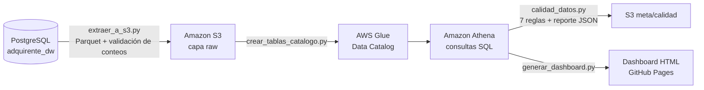

# Pipeline ETL en AWS para datos de un adquirente de pagos

Proyecto personal de ingeniería de datos. Toma datos transaccionales **simulados** de un adquirente de pagos (comercios, terminales, transacciones, liquidaciones), los extrae desde PostgreSQL, los deja en un data lake en Amazon S3 en formato Parquet, los cataloga en AWS Glue, los consulta con Amazon Athena y ejecuta validaciones de calidad de datos y publica un dashboard de indicadores.

**Dashboard en vivo:** https://leandrodlf.github.io/pipeline-etl-aws-adquirente/dashboard/

> Todos los datos son generados por un script. No hay información real de personas ni de empresas.

## Arquitectura



## Estado del proyecto

| Etapa | Estado |
|---|---|
| Origen simulado en PostgreSQL (12 tablas, 120.000 transacciones) | Listo |
| Extracción a S3 en Parquet, con validación de conteos origen vs destino | Listo |
| Catálogo de datos en AWS Glue Data Catalog (12 tablas, particiones) | Listo |
| Consultas analíticas en Amazon Athena | Listo |
| Validaciones de calidad de datos (7 reglas, reporte en S3) | Listo |
| Transformaciones con AWS Glue (PySpark) hacia una capa curated | Pendiente: jobs de Glue restringidos en mi cuenta nueva de AWS |
| Carga y modelo analítico en Amazon Redshift | Pendiente: Redshift Serverless bloqueado por política de la organización de AWS |
| Dashboard de indicadores publicado en GitHub Pages | Listo |

## Datos de origen

Base `adquirente_dw` con 12 tablas relacionadas: `comercios`, `sucursales`, `terminales`, `tarjetas`, `transacciones`, `lotes_cierre`, `liquidaciones`, `contracargos` y los catálogos `rubros`, `bancos_emisores`, `modelos_terminal` y `codigos_respuesta`.

- 500 comercios, 727 sucursales, 1.091 terminales y 5.000 tarjetas.
- 120.000 transacciones entre enero y noviembre de 2026, con una tasa de aprobación cercana al 92 %.
- 80.402 lotes de cierre y 15.444 liquidaciones que cuadran con las transacciones (bruto, comisión y neto).
- Incluye casos realistas: transacciones aún sin liquidar, terminales en bodega y contracargos.
- El generador **inyecta a propósito 58 inconsistencias** (30 liquidaciones donde el neto no es bruto menos comisión, 20 transacciones aprobadas sin código de autorización y 8 lotes con monto incorrecto). La etapa de calidad de datos las detecta todas (ver más abajo).

## Cómo está organizado

```
sql/01_schema.sql                 esquema del origen (12 tablas con sus relaciones)
src/generar_datos.py              genera y carga los datos simulados en PostgreSQL
src/extraer_a_s3.py               PostgreSQL -> Parquet en S3 (particionado por año/mes)
src/crear_tablas_catalogo.py      registra las tablas en el Glue Data Catalog
src/consultar_athena.py           ejecuta consultas SQL en Athena
src/calidad_datos.py              reglas de calidad de datos sobre Athena + reporte en S3
src/generar_dashboard.py          genera dashboard/index.html con indicadores desde Athena
dashboard/index.html              dashboard estático (publicado con GitHub Pages)
```

## Cómo ejecutarlo

Requisitos: Python 3.12 o superior, PostgreSQL (por ejemplo en Docker), AWS CLI con una sesión iniciada (`aws login`) y un bucket de S3.

```bash
pip install -r requirements.txt

# 1. Generar y cargar los datos simulados (variables PGHOST, PGPORT, PGUSER, PGPASSWORD)
python src/generar_datos.py

# 2. Extraer a S3 en Parquet
python src/extraer_a_s3.py --bucket <mi-bucket>

# 3. Registrar las tablas en el catálogo de Glue
python src/crear_tablas_catalogo.py --bucket <mi-bucket>

# 4. Consultar con Athena
python src/consultar_athena.py --bucket <mi-bucket>

# 5. Validar la calidad de los datos
python src/calidad_datos.py --bucket <mi-bucket> --detalle

# 6. Generar el dashboard (queda en dashboard/index.html)
python src/generar_dashboard.py --bucket <mi-bucket>
```

## Decisiones técnicas

- **Parquet con esquema explícito.** Los montos se guardan como `decimal(14,2)` y todos los archivos comparten el mismo esquema, para que Athena no falle por cambios de tipo entre particiones.
- **Partición por año y mes** en `transacciones` (11 archivos), con rutas tipo `anio=2026/mes=03/`.
- **Trazabilidad origen-destino.** Cada extracción compara las filas leídas en PostgreSQL con las escritas en Parquet y falla si no coinciden. Además guarda un manifiesto con los conteos en `meta/manifiestos/`.
- **Catálogo sin crawler.** En mi cuenta nueva de AWS la creación de crawlers de Glue está restringida a nivel de cuenta, así que registro las tablas con la API del Data Catalog, leyendo el esquema real de los archivos Parquet. El resultado en Athena es el mismo.
- **Calidad de datos como reglas SQL.** Cada regla es una consulta que devuelve las filas que la incumplen; el script compara los incumplimientos con lo esperado, guarda un reporte JSON en `meta/calidad/` y termina con error si algo no cuadra, para poder usarlo dentro de un flujo automático.
- **Scripts repetibles.** Se pueden ejecutar varias veces sin duplicar datos ni tablas.

## Ejemplo de resultado en Athena

Resumen mensual de transacciones (consulta de `consultar_athena.py`):

```
anio  mes  transacciones  pct_aprobacion  monto_aprobado
2026    1           3049            92.5     75464960.00
2026    2           9840            92.2    244339930.00
2026    3          11162            92.0    278453670.00
2026    4          10981            92.4    274165980.00
2026    5          11671            92.3    288616800.00
2026    6          11574            92.1    287568240.00
2026    7          12389            92.1    303589330.00
2026    8          12890            92.4    316766150.00
2026    9          13167            92.0    328287250.00
2026   10          14403            92.1    357647320.00
2026   11           8874            92.0    222341610.00

11 filas | datos escaneados: 469 KB
```

## Ejemplo de reporte de calidad

```
                 regla  esperado  encontrados  estado
    liq_neto_coherente        30           30      OK
tx_aprobada_con_codigo        20           20      OK
     lote_monto_cuadra         8            8      OK
       tx_sin_terminal         0            0      OK
     tx_monto_invalido         0            0      OK
      tx_id_duplicado          0            0      OK
tx_liquidada_inexistente       0            0      OK

Total de registros con problemas: 58
```

Las tres primeras reglas detectan las 58 inconsistencias inyectadas (30 + 20 + 8); las otras cuatro verifican integridad referencial, montos válidos y ausencia de duplicados.

## Hoja de ruta

1. Job de AWS Glue en PySpark hacia una capa curated, cuando la cuenta permita ejecutar jobs.
2. Carga a Amazon Redshift y modelo analítico, cuando la cuenta lo permita.

## Tecnologías

Python, SQL, PostgreSQL, Docker, Amazon S3, AWS Glue, Amazon Athena, Parquet, HTML/SVG/JavaScript (dashboard), GitHub Pages y Git.

## Autor

Leandro de la Fuente. Estudiante de Ingeniería en Informática.
